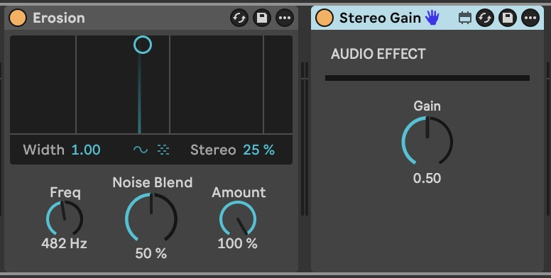
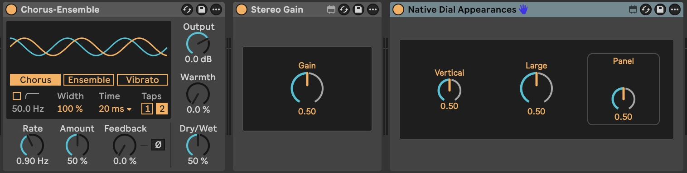
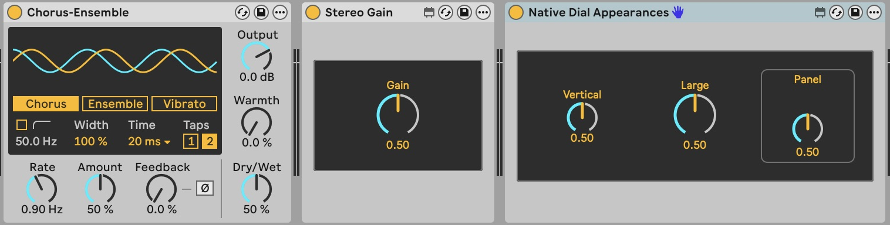

# Native inset presentation

`applyNativePresentation()` explicitly groups automatically placed registered
dials inside one native panel. It adds no internal device title or generic status
caption. Large remains the automatic default; `addLiveParameter()` accepts typed
`appearance: "vertical" | "panel" | "large"`. Unstyled programmatic defaults and
CLI `--bare` remain unchanged. Imported devices are never styled automatically.

```ts
const device = applyNativePresentation(
  addLiveParameter(
    createMaxForLiveDevice({ type: "audio", name: "My Effect" }),
    {
      id: "gain",
      name: "Gain",
      type: "float",
      min: 0,
      max: 1,
      default: 0.5,
      appearance: "large",
    },
  ),
);
```

Import from `max4live-ts-tools`. Use a locally packed reviewed candidate; this
presentation API is not in the registry's 0.2.0 release.

The panel is a noninteractive background object using native LCD Background,
LCD Line and small rounded corners. Automatically placed controls use native LCD
foreground colours for readable labels/values and needles. Existing custom
colour attributes win; explicit/native-saved control geometry and appearances
remain authored. The layout uses the actual verified 48/80/63px dial heights,
centres differently sized controls, and leaves the surrounding device background
visible. Background panels do not occupy parameter placement slots.

On restyling, only recognised, unconnected, unbound old toolkit headings/captions
and separators are removed. Matching IDs alone confer no ownership. Edited text,
scripting names, parameter bindings and connections preserve functional objects.
Repeated application is deterministic and does not accumulate decoration. Native
save drops private automatic-layout hints; those saved control positions stay
fixed. If a new automatic group cannot extend the saved inset without covering
intervening authored UI, the helper reports `PRESENTATION_CONFLICT`; provide
explicit parameter geometry rather than losing the existing backdrop.

## Actual Live captures

The request's written reference described Chorus-Ensemble's inset hierarchy; no
reference image was present in the attachment. These are actual Live captures
beside the stock Chorus-Ensemble device. No waveform, mode or fake processing UI
was added to the generated devices. The comparison dials are explicitly UI
examples, with identical 0–1 ranges/default 0.5 and stereo pass-through audio.

Previous Stereo Gain:




Revised Stereo Gain and all three native dial appearances:




The previous captures are the original PR qualification; revised captures were
made on 2026-10-16 in Live 12.4.6 / Max 9.1.5. Both used the Default theme with
Light/Dark appearances. This verification changes no fixed light/dark palette.
The user's original Follow System setting was restored afterward.

## Reproduce

From a clean source checkout on supported Node 22.12+ or Node 24, run `npm ci`
and `npm run examples`. Load `examples/generated/Native Dial Appearances.amxd`
in Live. The [source](../examples/dial-appearances.ts) uses the same public helpers
as Stereo Gain. Follow [Stereo Gain's packed-candidate instructions](../examples/stereo-gain/README.md)
to rebuild its standalone example against this unreleased source.

The [versioned native fixtures](../__tests__/fixtures/native-presentation.md)
record real Max serialization. Tests cover generated geometry, safe legacy
migration, manual edits, appearance selection, idempotence, parameter metadata,
unchanged Stereo Gain processing and byte-identical native container round-trips.
Max/Live are not required by CI. Frozen/encrypted editing remains unsupported.

## Revision verification

Both devices survived Edit in Max/save and a full Live Set close/reopen. Native
save retained all three dial styles, their labels and values, dynamic colour
expressions, and the inset's border/rounding. Screenshots above show the actual
same generated files in both appearances. No unexpected new Max console errors
were observed during the revision checks.

A fresh stereo capture through revised Stereo Gain measured peaks
0.100006/0.049988 at Gain 0.5, exact silence at 0, and 0.200012/0.100006 at 1.
Recorded Gain automation survived the Set reload; playback at its zero/unity/zero
intervals changed the actual native control to 0/1/0 and produced corresponding
silence/unity/silence in a second capture. The final zero Gain recalled before
playback. Both captures were 48 kHz/16-bit, starting 500 ms after initialisation;
first-vector behaviour was not measured. Processing boxes, complete connections,
parameter registration and value semantics match the earlier native Stereo Gain
fixture exactly, including the 10 ms ramp graph. Qualification left playback
stopped, the test source disabled and Follow System restored.
