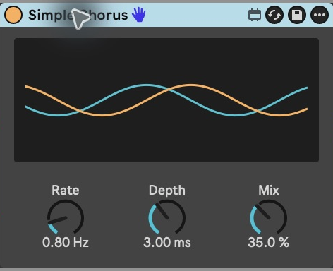

# Simple Chorus

A small, working stereo chorus built offline in TypeScript through the toolkit's
public exports. Drag [Simple Chorus.amxd](Simple%20Chorus.amxd) onto an audio
track in Live. The prebuilt device uses built-in Max objects and needs no scripts,
external assets or package installation.



| Control | Range    | Default | Effect                                            |
| ------- | -------- | ------- | ------------------------------------------------- |
| Rate    | 0.1–5 Hz | 0.8 Hz  | Speed of the delay modulation                     |
| Depth   | 0–8 ms   | 3 ms    | Modulation distance around a 15 ms delay          |
| Mix     | 0–100%   | 35%     | Linear blend from dry audio to the delayed signal |

Each input channel has its own delay buffer. One phasor drives two cosine LFOs,
90 degrees apart, for stereo movement. The delay varies between 7 and 23 ms at
maximum depth. Mix 0 is dry; Mix 100 is vibrato-like, fully delayed audio. Depth 0
leaves a fixed 15 ms delay on the wet path. Linear mixing can produce comb filtering
and level changes; no makeup gain, feedback, tempo sync or additional modes are
included. This is a simple chorus, not a recreation of Ableton Chorus-Ensemble.

Rate, Depth and Mix are registered Live parameters with Hz, ms and percent units.
Changes use 20 ms signal ramps. After Live restores the device, `live.thisdevice`
triggers the recalled controls at zero ramp time, then restores smoothing; it does
not overwrite recalled values with defaults.

Three standard `live.dial` controls retain their default appearance and theme
colours. Above them, two overlaid native `live.scope~` objects display two seconds
of the actual depth-scaled left/right LFO signals, refreshed about 30 times per
second. Rate changes the waves' speed and Depth changes their height; zero Depth
produces flat lines. The display observes the modulation and does not feed audio.
Its history length follows the DSP sample rate. The traces update while Live
processes the device; they can pause when Live suspends audio processing.

See Cycling '74's [tapin~](https://docs.cycling74.com/reference/tapin~/),
[tapout~](https://docs.cycling74.com/reference/tapout~/),
[phasor~](https://docs.cycling74.com/reference/phasor~/) and
[cos~](https://docs.cycling74.com/reference/cos~/) references.

## Build from TypeScript

Use Node 22.12+ or Node 24. This example builds against the published `0.2.0`
package without unreleased APIs.

```sh
cd examples/simple-chorus
npm ci
npm run build
npm test
```

Build output is `dist/Simple Chorus.amxd`. Tests compare it byte-for-byte with the
checked-in device, verify container round-tripping and check parameter, channel
and initialisation wiring. Root `npm run verify` builds and tests an isolated copy
against the packed package. These graph checks do not measure audio.

## Native verification

Tested in Live 12.4.6 / Max 9.1.5 at 48 kHz on 2026-10-16, using independent
440 Hz / 0.2 peak left and 880 Hz / 0.1 peak right test tones and 16-bit stereo
recordings. Settled ten-second windows measured:

| Setting                          | Left                          | Right                         |
| -------------------------------- | ----------------------------- | ----------------------------- |
| Mix 0                            | RMS 0.141421                  | RMS 0.070711                  |
| Mix 100, Depth 0                 | RMS 0.141421                  | RMS 0.070711                  |
| Mix 100, Depth 3 ms, Rate 0.8 Hz | Frequency deviation 6.635 Hz  | Frequency deviation 13.270 Hz |
| Mix 100, Depth 3 ms, Rate 2 Hz   | Frequency deviation 16.587 Hz | Frequency deviation 33.175 Hz |

Frequency deviations match a 3 ms sinusoidally varying delay. The measured stereo
modulation phase difference was 90 degrees at both rates. Average carriers remained
440 / 880 Hz. Native Edit in Max/save preserved object port counts and patchlines;
Rate 1.2 Hz, Depth 4 ms and Mix 40% survived closing and reopening a saved Live Set.
The subsequent display revision observes the same DSP graph; its motion, control
response and save/reopen are checked separately in Live. Tests do not establish
first-vector initialisation timing, perceptual quality for every source, or other
Live/Max versions. Qualification tools and recordings are not device dependencies.
