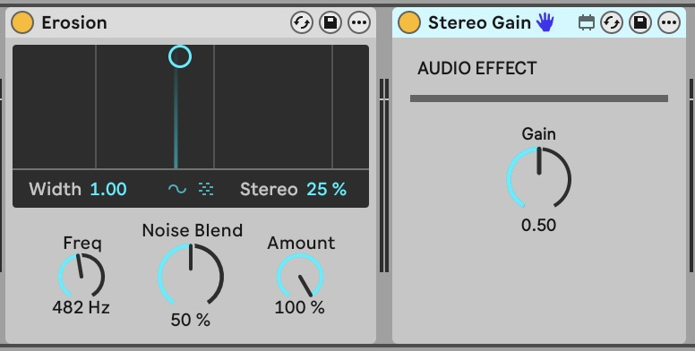

# Stereo Gain

A compact stereo audio effect built offline in TypeScript through the package's
public exports. It uses built-in Max objects only: no JavaScript runtime or
companion files. Native presentation is applied explicitly after constructing the
unchanged DSP graph.

## Build from TypeScript

Use Node 22.12+ within Node 22, or Node 24. Follow the
[source build instructions](../../CONTRIBUTING.md#build-the-examples-from-source),
selecting `examples/stereo-gain`. The styled device requires toolkit 0.3.0;
its manifest currently pins the published 0.2.0 baseline.

The [prebuilt Stereo Gain device](Stereo%20Gain.amxd) is checked byte-for-byte
against the generated output. Load it, or `dist/Stereo Gain.amxd`, on an audio
track in Live. Gain is linear: 0 silences
both channels, 0.5 is approximately −6.02 dB, and 1 preserves amplitude. Channels
remain separate. A single registered Gain dial controls both multipliers through
`pack 0. 10` and `line~ 0.5` (10 ms ramps).

`live.thisdevice` bangs after Live has initialised/restored the device. A
right-to-left `trigger` first sets ramp time to zero, bangs the dial's restored
value, then restores 10 ms smoothing. The signal's construction-time value is
also 0.5; there is no loadbang that overwrites a recalled parameter with a default.
See [line~](https://docs.cycling74.com/reference/line~/),
[pack](https://docs.cycling74.com/reference/pack/) and
[live.thisdevice](https://docs.cycling74.com/reference/live.thisdevice/).

`src/device.ts` uses explicit port counts for DSP objects and existing
`PatchBuilder.add()` helpers for messages and comments. It copies the small DSP
graph into the template through `PatchEditor.addBox()`, then connects it without
changing the public library or inventing a DSP framework.

Automated checks cover deterministic bytes, container round-tripping, valid
graphs, parameter/presentation metadata and initialisation connections. Repository
`npm run verify` also copies this project to an isolated directory, installs the
locally packed candidate and builds/tests it through the public package exports.
These checks do not measure audio or prove Live automation/recall behavior.

Native qualification on 2026-10-15 used Live 12.4.6 / Max 9.1.5, a disposable
Set, built-in oscillators (left: 440 Hz, peak 0.2; right: 880 Hz, peak 0.1), and
`sfrecord~ 2` captures at 48 kHz / 16-bit:

| Check                     | Measured result                                                                                                                         |
| ------------------------- | --------------------------------------------------------------------------------------------------------------------------------------- |
| Gain 0                    | Both recorded channels were exactly silent                                                                                              |
| Gain 0.5                  | Relative RMS gain: left 0.500001, right 0.499989 (approximately −6.02 dB)                                                               |
| Gain 1                    | Relative RMS gain: left 0.999997, right 0.999999                                                                                        |
| Independence              | Left 440 Hz amplitude 0.200000; right 880 Hz amplitude 0.100000 at unity; opposite tones absent at captured precision                   |
| Smoothing during playback | Captured 1%–99% rising envelope: 9.8125 ms                                                                                              |
| Automation                | Recorded 0 → 1 → 0 → 1; saved Set contained those events; playback after reopening reproduced silence/unity changes in captured audio   |
| State recall              | Gain 1 survived reopening and produced unity audio before playback                                                                      |
| Native save               | Opened through Live's Edit in Max, saved and reloaded; Max-saved object port counts matched the generated counts; Max console was empty |

The capture helper started 500 ms after initialisation. These recordings verify
settled recall and playback ramps; they do not measure the very first DSP vector
at device instantiation. Initialisation wiring and construction-time signal value
are covered separately by graph tests. Capture devices and Sets are qualification
tools, not dependencies of Stereo Gain or the ordinary test suite.

### Native presentation qualification — 2026-10-16

The styled candidate was tested separately in Live 12.4.6 / Max 9.1.5. The Large
Gain dial and reusable dark inset follow Live's appearance without separate
palettes. Native LCD foreground references keep labels, values and the needle
readable against LCD Background in both appearances. Real screenshots:

Audio, MIDI, silent instrument, playable sine, Stereo Gain and eight-parameter
interfaces loaded, rendered in light/dark, survived Edit in Max/save and a Live
Set save/reopen. Control interaction remained available; decoration added no
registered parameters. Long and wide-glyph names were inspected in Live.
Stock Erosion/Roar and Creative Extensions supplied visual references.

Fresh 48 kHz / 16-bit captures through the styled audio scaffold and Stereo Gain
measured peaks of 0.10001/0.04999 at Gain 0.5, 0.20001/0.10001 at Gain 1, and exact
silence at Gain 0. The 0.5 → 1 transition's 1%–99% rise was about 9.83 ms.
Recorded 0 → 1 → 0 automation survived Set reopening and reproduced silence/unity
in captured playback; the saved zero Gain also recalled. The styled MIDI scaffold
passed alternating note-on/off messages into the sine instrument (audible intervals
peaked at 0.07874 on both channels, alternating with silence). The silent scaffold
captured exact silence. As above, capture starts after 500 ms; first-vector
initialisation is covered by structural tests, not these recordings.

Live 11.3.43 additionally loaded and visually rendered styled Stereo Gain; full
DSP/automation qualification was performed in Live 12, not Live 11.

The inset revision removes the internal AUDIO EFFECT heading and separator;
Stereo Gain still has exactly one registered parameter and the same processing,
smoothing and initialisation graph. [Before/after and the three-dial comparison](../../docs/native-presentation.md).

The revised inset candidate was requalified in Live 12.4.6 / Max 9.1.5 with native
save/reload, zero Gain recall and recorded 0/1/0 automation replay. Fresh capture
peaks were 0.100006/0.049988 at Gain 0.5, 0.200012/0.100006 at 1, and exact silence
at 0. The native-saved processing graph and parameter semantics match the prior
fixture exactly; the inset and palette introduce no DSP changes.
